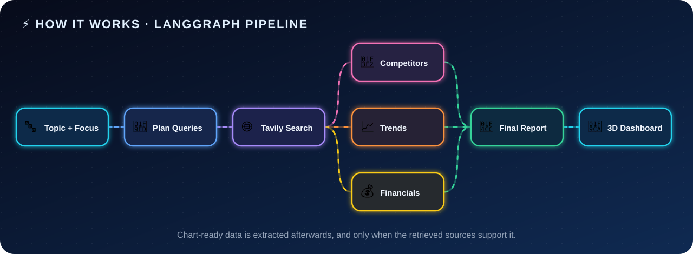
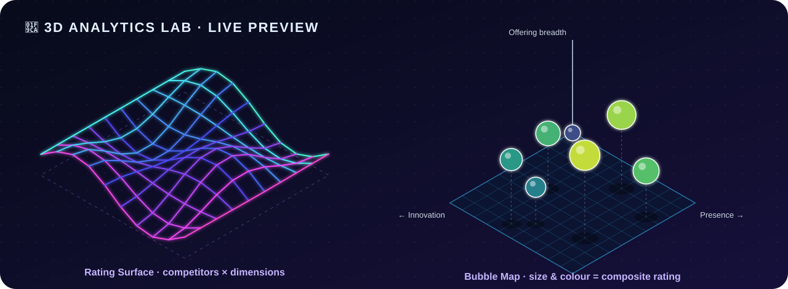

<div align="center">



<br/>

<a href="#-quick-start"></a>

<br/><br/>

**Turn any company, product, or industry question into a source-backed market brief,<br/>with interactive 3D analytics and zero fabricated numbers.**

[✨ Why](#-why-this-exists) · [🚀 Features](#-features) · [⚡ How it works](#-how-it-works) · [🧊 3D Lab](#-the-3d-analytics-lab) · [🛡️ Safeguards](#%EF%B8%8F-evidence-first-by-design) · [⚙️ Quick start](#-quick-start)

</div>


## ✨ Why this exists

Most AI "research" tools hand you one confident, unverifiable paragraph. **Market Intelligence Studio** works the way a real analyst does:

> 🧭 It **plans** its searches → 🌐 **gathers** live sources → 🧠 analyzes competitors, trends, and financials **separately** → 📌 **synthesizes** one report → 🧊 draws charts **only when the evidence supports them**.

Every claim traces back to a retrieved source. Every rating is labeled as a judgment. Every chart is skipped if the data isn't there.


## 🧰 Built with


## 🚀 Features

| | Feature | What it does |
|:-:|---|---|
| 🧭 | **Planned research** | An LLM proposes five targeted queries: position, competitors, trends, recent news, financials. If its output is malformed, deterministic fallback queries fill the gaps. |
| 🌐 | **Live web evidence** | Tavily returns up to 5 results per query. Results are deduplicated by URL and keep title, content, query, and relevance score. |
| ⚡ | **Parallel analysts** | Competitor, trend, and financial analyses run as independent LangGraph branches, then merge into one report. |
| 📌 | **Executive report** | Summary, market position, findings, opportunities, risks, next steps, and **evidence limitations**. Download as Markdown. |
| 🧊 | **3D Analytics Lab** | Custom `Mesh3d` bars, rating surfaces, bubble maps, and linked subplots with one-click camera presets. |
| 🔎 | **Inspectable sources** | Every source is listed with its query and relevance score. Export as CSV. |
| 🛡️ | **No fabricated data** | Charts render only when the retrieved evidence supports them. |


## ⚡ How it works



The workflow is a typed **LangGraph** state machine. After web research, the three analysis nodes fan out **in parallel**, and the synthesis node waits for all three. Chart-data extraction then runs on the collected evidence (up to 18 sources, capped at 24,000 characters).

<details>
<summary><b>🧠 Meet the three analysts (click to expand)</b></summary>

<br/>

| Analyst | Persona | Rules it follows |
|---|---|---|
| 🏢 **Competitors** | Skeptical market analyst | Separates confirmed facts from judgments. Never invents market shares, scores, or prices. |
| 📈 **Trends** | Evidence-driven industry analyst | Labels uncertain or conflicting evidence. No manufactured time series or forecasts. |
| 💰 **Financials** | Careful financial analyst (not an adviser) | Reports figures only if present, with period, currency, and source URL. |

</details>


## 🗂️ The dashboard

| Tab | What you get |
|---|---|
| 📌 **Executive Report** | The synthesized brief, with a Markdown download |
| 🏢 **Competitors** | Written landscape, 3D scatter, 2D positioning map, expandable ratings table |
| 📈 **Trends** | Evidence-led analysis and a chart of years mentioned in sources |
| 💰 **Financials** | Snapshot plus grouped bar charts, one metric and unit at a time |
| 🧊 **3D Lab** | Competitor 3D, Financial 3D, and Evidence 3D |
| 🔎 **Sources** | Titles, queries, clickable URLs, relevance scores, CSV export |

A metrics row at the top shows **sources collected**, **competitors identified**, and **financial records**.


## 🧊 The 3D Analytics Lab



<sub>☝️ Illustrative animation of the chart styles, drawn with sample data. In the app the same views are fully interactive Plotly charts.</sub>

> [!TIP]
> Every 3D chart has **camera preset buttons** (*Default · Top · Front · Side · Low angle*), plus drag-to-rotate, scroll-to-zoom, and rich hover cards with the rationale and source.

<table>
<tr>
<td width="33%" valign="top">

### 🏢 Competitor 3D
- **Bubble Map:** presence × innovation × breadth, with drop-lines. Size and color show the composite rating.
- **Rating Surface:** competitors × dimensions (needs 2+ competitors).
- **Linked Subplots:** three panels, three color lenses, one set of camera buttons.

</td>
<td width="33%" valign="top">

### 💰 Financial 3D
- Hand-built **3D bars**: cube geometry assembled into a single `Mesh3d`.
- Companies × reporting periods.
- **One metric and unit at a time**, so axes are always comparable.

</td>
<td width="33%" valign="top">

### 🔎 Evidence 3D
Charts about the *research itself*, not the market:
- **Evidence Bars:** query × year mentioned × source count.
- **Density Surface:** the same data, smoothed.
- **Source Map:** relevance × query × content length.

</td>
</tr>
</table>

The composite rating is the mean of market presence, innovation, and offering breadth.


## 🛡️ Evidence-first by design

| ✅ Safeguard | How it works |
|---|---|
| **No invented financials** | A value is plotted only with a metric, period, unit, and source URL. |
| **No mixed axes** | Data is grouped by metric *and* unit, so revenue never shares an axis with funding, or USD with another currency. |
| **Ratings are labeled** | The 1–10 competitor scores are qualitative, AI-assisted assessments with a rationale, **not** verified market data. |
| **Validated inputs** | Numeric fields are coerced, out-of-range ratings dropped, duplicate competitors removed. |
| **Honest chronology** | The year chart counts years *mentioned in sources*. It is not a growth or sales time series. |
| **Graceful degradation** | Thin evidence produces a clear message, never a made-up chart. The report and sources always remain. |
| **Bounded and stable** | Analysis context is capped at 42,000 characters; temperature is `0`. |


## ⚙️ Quick start

**You need:** Python 3.10+, an [OpenAI API key](https://platform.openai.com/), and a [Tavily API key](https://tavily.com/). API usage may incur charges.

**1 · Install**

```bash
# macOS / Linux
python3 -m venv .venv && source .venv/bin/activate
pip install -r requirements.txt
cp .env.example .env
```

```powershell
# Windows PowerShell
python -m venv .venv
.\.venv\Scripts\Activate.ps1
pip install -r requirements.txt
Copy-Item .env.example .env
```

**2 · Add your keys** to `.env`

```dotenv
OPENAI_API_KEY=your_openai_api_key
TAVILY_API_KEY=your_tavily_api_key
```

**3 · Run**

```bash
streamlit run app.py
```

Open the local URL Streamlit prints in your terminal.

### 🎯 Try these

| Enter | Focus |
|---|---|
| `NVIDIA` | market position, competitors, and financial snapshot |
| `Electric vehicles` | emerging trends, risks, and opportunities |
| `Indian quick commerce` | competitive landscape and recent funding |


## 📁 Project structure

```text
├── app.py              # Streamlit UI, LangGraph workflow, prompts, 2D/3D charts
├── requirements.txt    # Python dependencies
├── .env.example        # API key template (copy to .env)
├── .streamlit/
│   └── config.toml     # Streamlit theme
└── assets/             # Animated SVGs used by this README
```

## ⚠️ Limitations

> [!WARNING]
> LLM-generated analysis can be incomplete or wrong. **Open the sources and verify important claims**, especially before financial or business decisions.

- Competitor ratings are qualitative; financial charts depend on figures actually present in retrieved snippets.
- Search uses Tavily's `basic` depth with 5 results per query, so coverage depends on what is returned.
- Results live in Streamlit session state only. There is no database, authentication, or deployment config.

## 🗺️ Roadmap

- [ ] Persistent report history and side-by-side run comparison
- [ ] PDF export of the executive report
- [ ] Deeper search mode and source-quality weighting
- [ ] One-click deployment (Streamlit Community Cloud or Docker)


<div align="center">

**📊 Research • Compare • Discover**

<sub>Keep `.env` private. Never commit real API keys.</sub>

</div>
