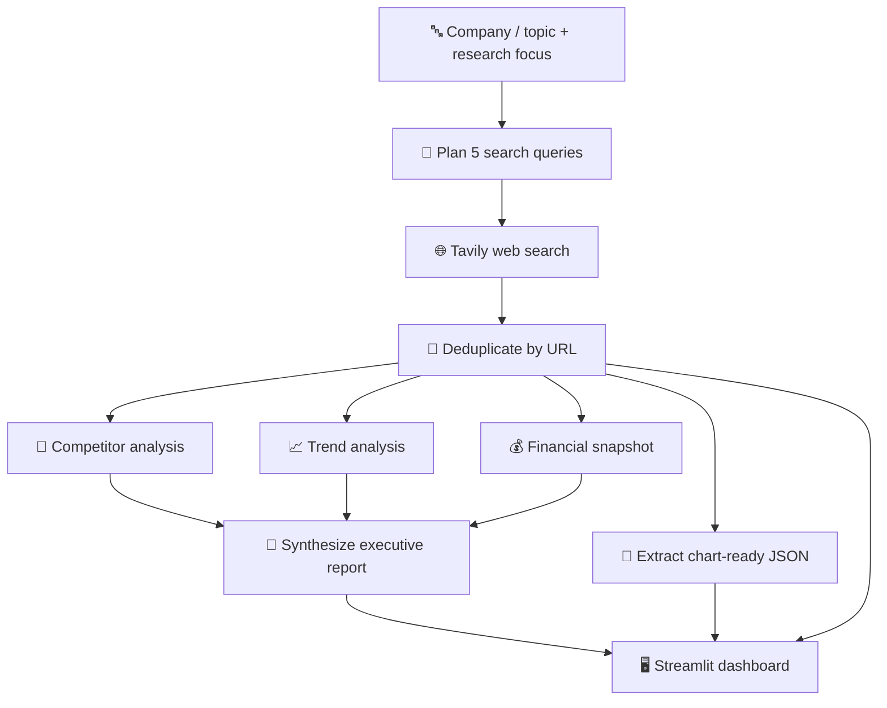

# evidence-first-market-research
<div align="center">

# 📊 Market Intelligence Studio

### Turn any company, product, or industry question into a **source-backed market brief**, with interactive 3D analytics.


**Research • Compare • Discover**

[Features](#-features) · [How it works](#-how-it-works) · [3D Lab](#-the-3d-analytics-lab) · [Quick start](#-quick-start) · [Safeguards](#-evidence-first-by-design) · [Limitations](#-limitations)

</div>

---

## ✨ Why this exists

Most AI "research" tools hand you one confident, unverifiable paragraph. **Market Intelligence Studio** works the way an analyst would:

> It plans its searches, gathers sources, analyzes competitors, trends, and financials **separately**, then synthesizes a report, and it never invents a number to make a chart look good.

Every claim traces back to a retrieved source. Every rating is labeled as a judgment. Every chart is skipped if the evidence doesn't support it.

<!--
📸 Add a screenshot or GIF here once you have one:
<p align="center"></p>
-->

---

## 🚀 Features

| | |
|---|---|
| 🧭 **Planned research** | An LLM proposes five targeted queries: position, competitors, trends, recent news, financials/funding. Malformed output? Deterministic fallback queries fill the gaps. |
| 🌐 **Live web evidence** | Tavily retrieves up to 5 results per query. Results are deduplicated by URL and keep their title, content, originating query, and relevance score. |
| ⚡ **Parallel analysts** | Competitor, trend, and financial analyses run as independent LangGraph branches, then merge into one executive report. |
| 📌 **Executive report** | Summary, market position, key findings, opportunities, risks, next steps, and **evidence limitations**. Downloadable as Markdown. |
| 🧊 **3D Analytics Lab** | Custom `Mesh3d` bars, rating surfaces, bubble maps, and linked subplots with one-click camera presets. |
| 🔎 **Inspectable sources** | A dedicated tab lists every source with its query and relevance score. Export as CSV. |
| 🛡️ **No fabricated data** | Charts render only when the evidence supports them. See [Evidence-first by design](#-evidence-first-by-design). |

---

## 🧠 How it works



The workflow is a typed **LangGraph** state machine (`ResearchState`). After web research, the three analysis nodes fan out in parallel, and the synthesis node waits for all three. Chart-data extraction runs afterwards on the collected evidence (up to 18 sources, capped at 24,000 characters).

**Each analyst has its own instructions:**

- **Competitors:** "skeptical market analyst"; separates confirmed facts from qualitative judgments; never invents market shares, scores, or prices.
- **Trends:** "evidence-driven industry analyst"; labels uncertain or conflicting evidence; no manufactured time series or forecasts.
- **Financials:** "careful financial research analyst, not a financial adviser"; reports figures only if present, with period, currency, and source URL.

---

## 🗂️ The dashboard

| Tab | What you get |
|---|---|
| 📌 **Executive Report** | The synthesized brief with a Markdown download |
| 🏢 **Competitors** | Written landscape, 3D scatter, 2D positioning map, and an expandable ratings table |
| 📈 **Trends** | Evidence-led trends analysis and a chart of years mentioned in sources |
| 💰 **Financials** | Snapshot plus grouped bar charts, one metric and unit at a time |
| 🧊 **3D Lab** | Competitor 3D, Financial 3D, and Evidence 3D |
| 🔎 **Sources** | Titles, queries, clickable URLs, relevance scores, and CSV export |

A live metrics row shows **sources collected**, **competitors identified**, and **financial records** at a glance.

---

## 🧊 The 3D Analytics Lab

Every 3D chart has **camera preset buttons** (*Default · Top · Front · Side · Low angle*), plus drag-to-rotate and scroll-to-zoom.

### 🏢 Competitor 3D
- **3D Bubble Map:** competitors plotted by market presence × innovation × offering breadth, with drop-lines to the floor. Bubble size and color encode the composite rating.
- **Rating Surface:** competitors (ranked) × dimensions → rating. Needs at least two competitors.
- **Linked Subplots:** the same competitors in three panels, each colored by a different dimension. Camera buttons control all three panels at once.

### 💰 Financial 3D
- Hand-built **3D bar charts** (cube geometry assembled into a single `Mesh3d` trace) comparing companies across reporting periods for **one metric and unit at a time**.

### 🔎 Evidence 3D
Charts about the research itself, not about the market:
- **Evidence Bars:** research query × year mentioned × number of sources.
- **Density Surface:** the same data as a smooth surface.
- **Source Map:** relevance score × query × content length.

> The composite rating is the mean of market presence, innovation, and offering breadth.

---

## 🛡️ Evidence-first by design

This project treats honesty as a feature:

- ✅ **No invented financials.** A value is plotted only if it has a metric, period, unit, and source URL.
- ✅ **No mixed axes.** Financial data is grouped by metric *and* unit, so revenue never shares an axis with funding, or USD with other currencies.
- ✅ **Ratings are labeled as judgments.** The 1–10 competitor scores are qualitative, AI-assisted assessments with a rationale and source, **not** verified market measurements.
- ✅ **Validated inputs.** Numeric fields are coerced; out-of-range ratings are dropped; duplicate competitor names are removed.
- ✅ **Honest chronology.** The year chart counts years *mentioned in sources*. It is explicitly not a growth or sales time series.
- ✅ **Graceful degradation.** If extraction fails or evidence is thin, the app shows a clear message instead of a made-up chart. The written report and sources always remain.
- ✅ **Bounded context.** Analysis text is capped at 42,000 characters, with temperature `0` for consistent outputs.

---

## 🧰 Tech stack

| Layer | Technology |
|---|---|
| UI | **Streamlit**, with custom CSS for a polished dashboard theme |
| Orchestration | **LangGraph** (typed state, parallel branches, join node) |
| LLM | **OpenAI `gpt-4.1-mini`** via **LangChain** (`temperature=0`) |
| Search | **Tavily** |
| Data | **Pandas** |
| Visualization | **Plotly** Express + Graph Objects (`Scatter3d`, `Surface`, custom `Mesh3d`) |
| Config | **python-dotenv** |

---

## ⚡ Quick start

**Requirements:** Python 3.10+, an [OpenAI API key](https://platform.openai.com/), and a [Tavily API key](https://tavily.com/). API usage may incur charges.

### 1. Install

```bash
# macOS / Linux
python3 -m venv .venv
source .venv/bin/activate
pip install -r requirements.txt
cp .env.example .env
```

```powershell
# Windows PowerShell
python -m venv .venv
.\.venv\Scripts\Activate.ps1
pip install -r requirements.txt
Copy-Item .env.example .env
```

### 2. Add your keys

```dotenv
OPENAI_API_KEY=your_openai_api_key
TAVILY_API_KEY=your_tavily_api_key
```

### 3. Run

```bash
streamlit run app.py
```

Open the local URL Streamlit prints in your terminal.

---

## 🎯 Try it with

- `NVIDIA` → *market position, competitors, and financial snapshot*
- `Electric vehicles` → *emerging trends, risks, and opportunities*
- `Indian quick commerce` → *competitive landscape and recent funding*

---

## 📁 Project structure

```text
market-intelligence-studio/
├── app.py              # Streamlit UI, LangGraph workflow, analysis prompts, 2D/3D charts
├── requirements.txt    # Python dependencies
├── .env.example        # API key template (copy to .env)
├── .gitignore          # Excludes secrets and local Python artifacts
└── .streamlit/
    └── config.toml     # Streamlit theme settings
```

---

## ⚠️ Limitations

- LLM-generated analysis can be incomplete or wrong. **Open the sources and verify important claims**, especially before financial or business decisions.
- Competitor ratings are qualitative; financial charts depend on figures actually present in retrieved snippets.
- Search runs at Tavily's `basic` depth with 5 results per query, so coverage depends on what is returned.
- Results live in Streamlit session state only. There is no database, authentication, multi-user support, or deployment configuration.

## 🗺️ Ideas for next steps

- Persistent report history and side-by-side comparison of runs
- PDF export of the executive report
- Deeper search mode and source-quality weighting
- Deployment recipe (Streamlit Community Cloud or Docker)

---

<div align="center">

**Research • Compare • Discover**

*Keep `.env` private. Never commit real API keys.*

</div>
